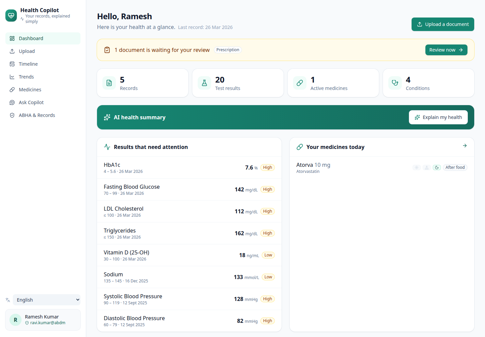
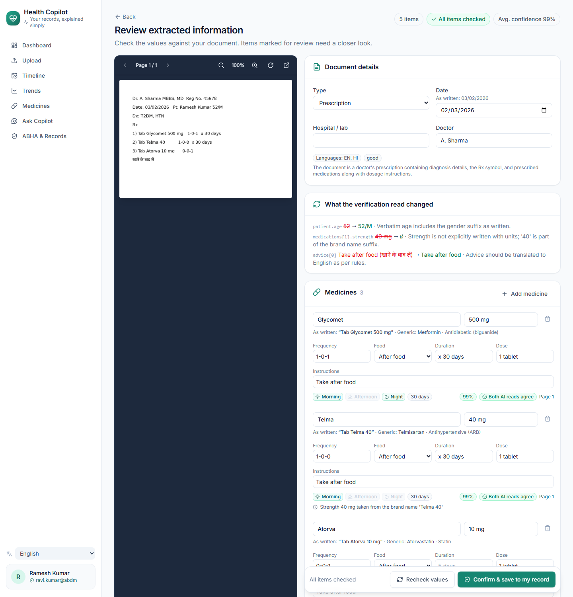
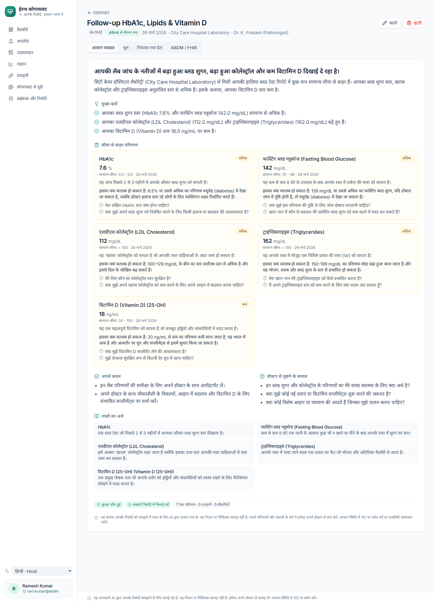
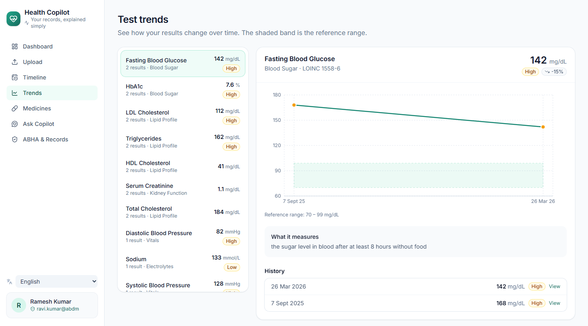
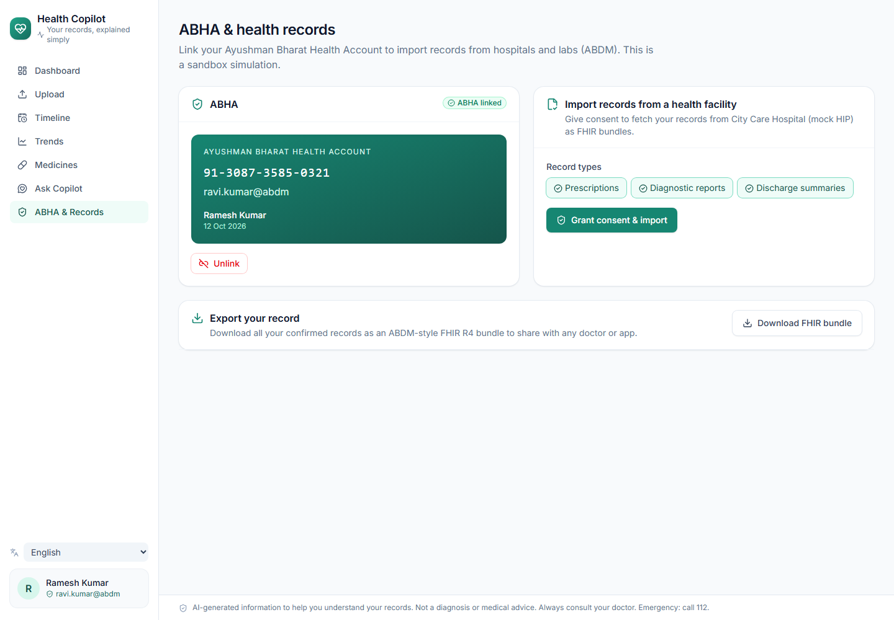

# Health Copilot: AI-powered personal health copilot

Health Copilot turns photos and PDFs of prescriptions, lab reports and discharge summaries into a verified, unified
health record. It explains abnormal values in plain language, in English, Hindi, Telugu, Tamil or Kannada, and
exports everything as ABDM-ready FHIR R4 with a mock ABHA link.

*Built for the Altrix Labs hackathon, "AI-Powered Personal Health Copilot".*



| | |
|---|---|
|  |  |
| Side-by-side review with confidence and verifier changes | Plain-language summary in Hindi |
|  |  |
| Trends with reference ranges | Mock ABHA link and import, FHIR export |

## What it does

- **Ingest:** drag and drop, or use the phone camera. PDF, JPG, PNG and WEBP are accepted, multi-page documents
  included. Printed, handwritten, bilingual and regional-script documents all work.
- **Extract:** medicines with strength, dose, a morning/afternoon/night schedule, meal timing and duration; test
  values with units and reference ranges; diagnoses with ICD-10 codes; vitals; dates; doctor and facility.
- **Verify:**
  - A second model re-reads the page, guided by the validators' suspicious fields.
  - Code checks units, ranges, flags, drug names, dosage grammar, dates and plausibility.
  - A person confirms every document on a side-by-side review screen before anything is saved.
- **Explain:** plain-language summaries that cover what each abnormal result may mean, questions to ask the doctor,
  the medicine schedule and a glossary. They pass safety checks: no dosing advice, no diagnosis, and every number
  must come from the record. They are translated with all numbers preserved.
- **Unified profile:** dashboard, timeline, trends with shaded reference ranges, active and past medicines, and
  critical-value banners.
- **Ask my records:** chat grounded only in the patient's own records, with citations and emergency detection.
- **ABDM readiness:**
  - Every document becomes an NRCeS-profile FHIR R4 bundle, and the whole record exports as one bundle.
  - Mock ABHA flow: link with OTP, consent artefact, and import from a mock Health Information Provider.

**Measured accuracy** ([`eval/report.md`](eval/report.md)): on 10 synthetic documents with 96 items, the pipeline
with verification got 100% of 477 checked fields right; the single pass got 99.8%. The test set covers printed,
handwritten, phone-photo, PDF, Hindi, Telugu, Tamil and Kannada documents. This is a regression suite, not a
clinical validation; see the report for caveats.

Docs: [architecture](docs/architecture.md) · [slides](docs/slides.md) ([PDF](docs/slides.pdf)) · [3-minute demo script](docs/demo_script.md)

## Quick start (local development)

Requirements: Python 3.12, Node 22, and a [Gemini API key](https://aistudio.google.com/apikey). OpenAI also works.

```bash
# backend
cd backend
python3 -m venv .venv && .venv/bin/pip install -r requirements.txt
cp .env.example .env            # then put your key in GEMINI_API_KEY
.venv/bin/uvicorn app.main:app --port 8000 --reload --reload-dir app

# frontend (second terminal)
cd frontend
npm install
npm run dev                     # http://localhost:5173 (proxies /api to :8000)
```

Or use the control script, which runs both servers in the background with logs in `.run/`:

`setup` also installs what the system is missing, as far as possible without touching the system:

- **Node 22:** uses an existing Node 20.19+/22.12+ (including nvm or volta installs); otherwise downloads the
  official build from nodejs.org into `.tools/node`.
- **Python 3.11–3.13 with venv:** uses the system Python; otherwise installs [uv](https://docs.astral.sh/uv/) in
  `~/.local/bin` and uses a standalone Python 3.12.
- **lsof, curl, python3-venv:** installed with apt when missing (asks for your sudo password).

It also works with `sudo ./run.sh setup`: only the apt packages are installed as root, and the project files stay
owned by you.

```bash
./run.sh setup                 # first time: system packages, virtualenv, pip and npm install, backend/.env
./run.sh start                 # backend :8000 + frontend :5173
./run.sh status
./run.sh restart [backend|frontend]
./run.sh logs [backend|frontend]
./run.sh stop
HOST=0.0.0.0 ./run.sh start    # open from a phone on the same Wi-Fi (camera upload)
```

After a `git pull`, just run `./run.sh restart`: start and restart first install any packages added to
`backend/requirements.txt` or `frontend/package-lock.json` since the last install.

### Accounts

Anyone can create an account with an email address or a mobile number (any of 20 countries, India by default) and a password. Each account sees
only its own profiles and documents, and can hold several profiles, for example parents or children. Requests for
another account's records return 404. Sessions use an HttpOnly cookie (30 days), passwords are stored as scrypt
hashes, and repeated wrong passwords are throttled.

To load a demo account (`demo@healthcopilot.in`, password `demo12345`) with a patient, an ABHA link and a year of
records (no LLM calls needed):

```bash
backend/.venv/bin/python scripts/seed_demo.py
# optionally also run real documents through the pipeline:
backend/.venv/bin/python scripts/seed_demo.py --confirm lab_diabetes_lipid_pdf,rx_handwritten_diabetes --review rx_handwritten_photo
# use your own account instead:
backend/.venv/bin/python scripts/seed_demo.py --login you@example.com --password '...'
```

The demo ABHA OTP is `123456`.

Profiles created before accounts existed have no owner and are hidden. Give them to an account with:

```bash
cd backend && .venv/bin/python -m app.manage accounts                      # list accounts and profiles
cd backend && .venv/bin/python -m app.manage assign-orphans demo@healthcopilot.in
```

### Docker

```bash
cp backend/.env.example backend/.env   # add your key
docker-compose up --build              # http://localhost:8080 (Postgres + backend + nginx frontend)
```

### Behind a TLS-inspecting corporate proxy

If HTTPS calls fail with certificate errors, for example behind Zscaler:

- **Backend:** point `CA_BUNDLE` in `backend/.env` at a PEM file that contains the system CAs plus the proxy's root CA.
- **npm:** set `NODE_EXTRA_CA_CERTS=/path/to/proxy-root.pem`.

## Configuration (`backend/.env`)

| Variable | Default | Notes |
|---|---|---|
| `LLM_PROVIDER` | `gemini` | `gemini` or `openai` |
| `GEMINI_API_KEY` / `OPENAI_API_KEY` | — | Required for extraction, summaries and chat |
| `GEMINI_EXTRACT_MODELS`, `GEMINI_VERIFY_MODELS`, `GEMINI_FAST_MODELS` | see `.env.example` | Comma-separated fallback chains per role. The first available model wins; quota or overload errors move to the next. Verification starts on a different model from extraction. |
| `ENABLE_VERIFICATION` | `true` | Turns the second-model read on or off |
| `DATABASE_URL` | SQLite in `backend/data` | e.g. `postgresql+psycopg://…` |
| `CA_BUNDLE` | — | Custom CA bundle for TLS-inspecting proxies |
| `SESSION_DAYS` | `30` | How long a sign-in lasts |
| `COOKIE_SECURE` | `false` | Set `true` when served over HTTPS |

The **Gemini free tier allows only about 20 requests per model per day**. One document uses 3 requests (classify,
extract, verify), and each summary or chat answer uses one or two more. For demos and evaluation runs, use a key with
billing enabled.

## Tests and evaluation

```bash
cd backend && .venv/bin/python -m pytest -q        # 60 unit tests: validators, knowledge base, FHIR, ABHA, safety, records
backend/.venv/bin/python eval/make_samples.py      # regenerate the 10 synthetic documents + ground truth (deterministic)
backend/.venv/bin/python eval/run_eval.py         # run the pipeline on all samples and write eval/report.md (about 30 LLM calls)
backend/.venv/bin/python eval/run_eval.py --rescore eval/runs/<run>   # re-score saved outputs without LLM calls
backend/.venv/bin/python scripts/e2e_smoke.py      # end-to-end API check against a running backend (about 6 LLM calls)
```

## Project layout

```
backend/app/
  pipeline/    preprocess (PDF render, text layer, deskew, CLAHE) · extract (classify/extract/verify) · validate · runner · llm
  knowledge/   lab_ranges.json (60 LOINC tests) · drugs_india.csv (213 brands) · dosage_terms.json · icd10.json · mock HIP records
  fhir/        mapper (NRCeS profiles) · bundle (document bundles, patient export, FHIR import)
  services/    records (confirm + medicine reconciliation) · summary · chat · facts · safety · abha_mock
  api/         patients · documents · insights (summary, chat, ABHA)
  models/      SQLModel tables shaped like FHIR resources
frontend/src/  pages (Dashboard, Upload, Review, DocumentView, Timeline, Trends, Medications, Chat, Abha) · components · i18n (en, hi, te, ta, kn)
eval/          make_samples.py · samples/ (documents + ground truth) · run_eval.py · report.md · notes.md
scripts/       seed_demo.py · e2e_smoke.py
docs/          architecture.md (+ PNG diagrams) · slides.md / slides.pdf · demo_script.md · screenshots/
```

## Safety notes

- **This is a prototype, not a medical device.** It does not diagnose and never suggests changing medicines. Every
  screen shows a disclaimer. Critical values show a "contact a doctor or seek urgent care" banner, and emergency
  symptoms in chat show the 112 notice.
- **Code decides what is abnormal.** High, Low and Critical flags, unit conversions, codes and schedules are computed
  deterministically. The AI explains them and writes prose only.
- **Nothing is saved without human confirmation.** Low-confidence, disputed and verifier-added items are highlighted
  for review.
- **Privacy:**
  - Records stay in the local database.
  - Page images go to the configured LLM provider for extraction.
  - Summaries and chat receive fact sheets with gender, age and clinical facts only: no name, phone number or ABHA
    identifier.
  - Each account sees only its own records. *Delete account* (API: `POST /api/auth/delete-account`) removes the
    account, its profiles, records and uploaded files.
  - For production you would also need encryption at rest, HTTPS (`COOKIE_SECURE=true`), and a provider agreement
    that meets the DPDP Act.

## Security

- API keys belong only in `backend/.env`, which is gitignored. Never commit them.
- **Rotate any key that has been shared in chat or screenshots,** and set a usage limit on the provider dashboard.

## Credits and licences

- The synthetic handwriting samples use [Kalam](https://fonts.google.com/specimen/Kalam) and
  [Caveat](https://fonts.google.com/specimen/Caveat) (SIL Open Font License 1.1), which are bundled in `eval/fonts/`.
- Reference ranges and drug data are curated for demonstration. Verify them before any clinical use.
- FHIR profiles follow the [NRCeS ABDM implementation guide](https://nrces.in/ndhm/fhir/r4/).
