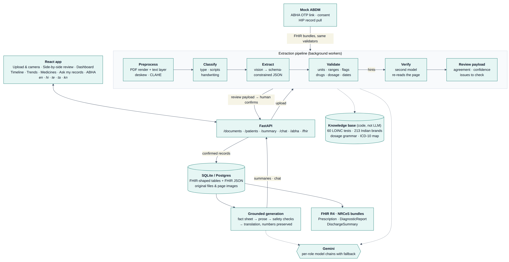
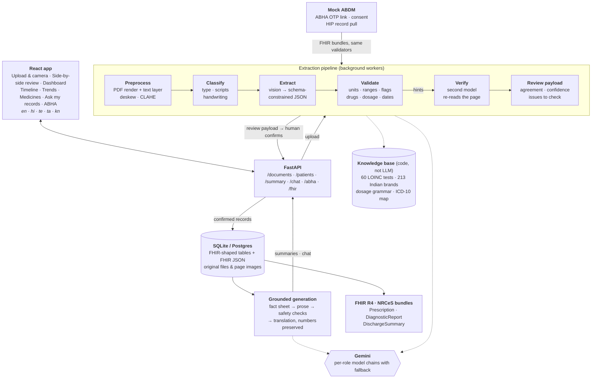
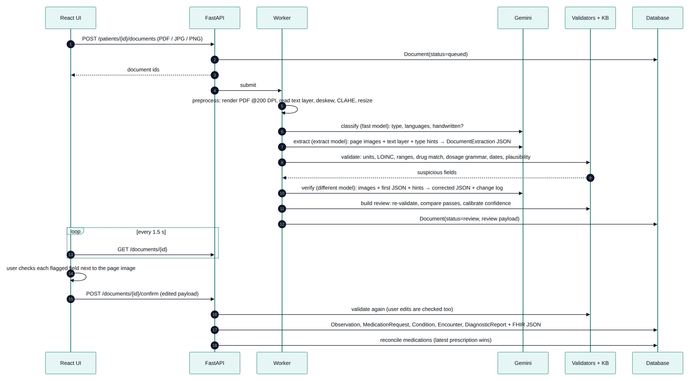
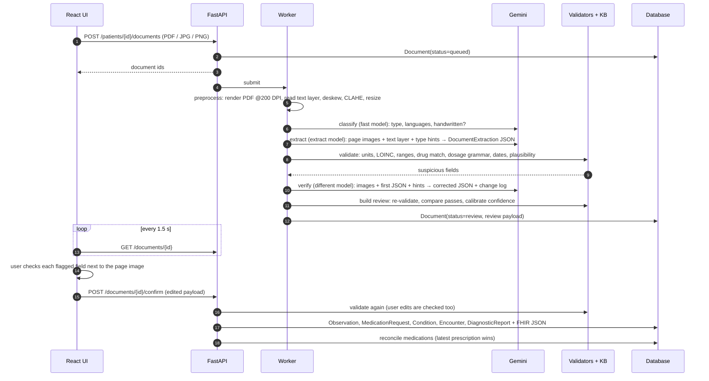
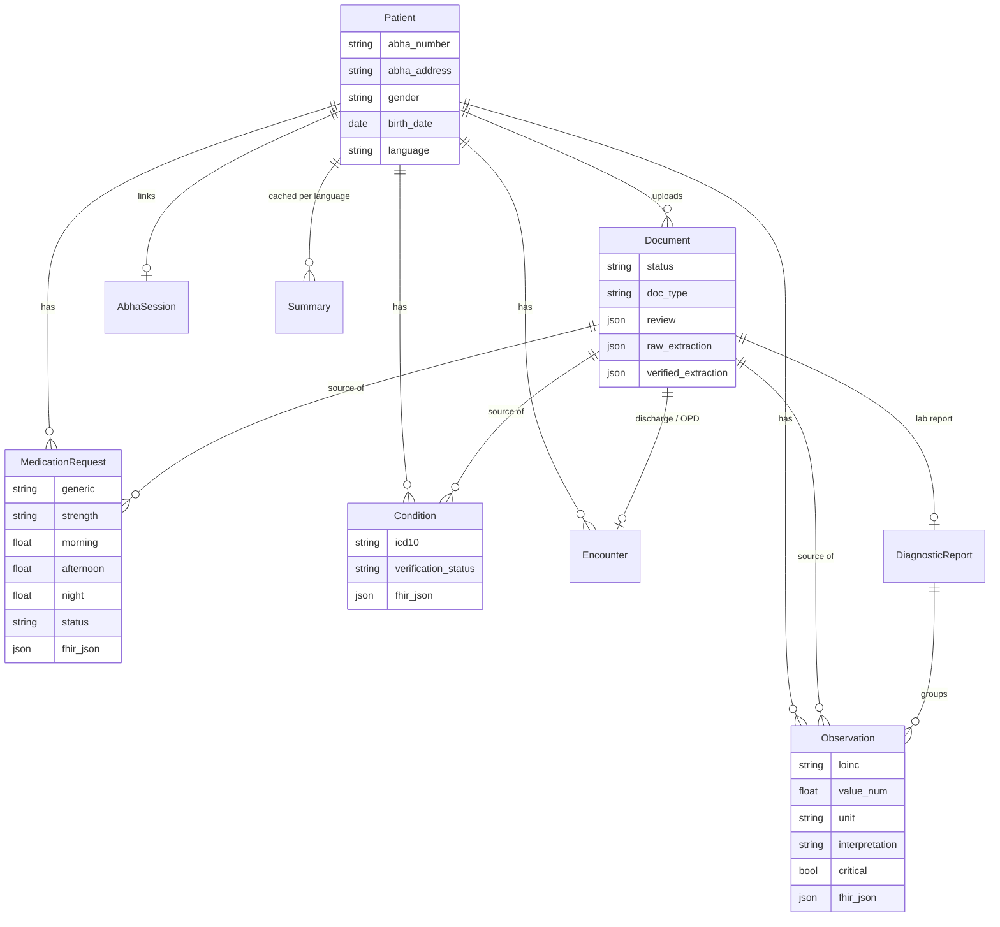
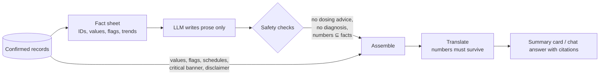

# Architecture

Health Copilot turns photos and PDFs of Indian medical documents into a verified, FHIR-shaped health record. It then
explains that record in plain language, in English, Hindi, Telugu, Tamil or Kannada.

The design follows one rule: **the language model reads and writes, code decides.** Gemini reads documents and writes
explanations. Deterministic code owns everything that has to be right:

- units and reference ranges;
- High, Low and Critical flags;
- drug and test codes;
- dates and medicine schedules;
- the numbers shown to the user.

A human confirms every extraction before it reaches the record.

## System overview

Mermaid source

## Document pipeline

Mermaid source

### Stage details

| Stage | Module | What it does |
|---|---|---|
| Preprocess | `pipeline/preprocess.py` | Renders PDF pages at 200 DPI and keeps the text layer. Estimates and corrects skew (the photo samples are rotated by about 5°), applies CLAHE contrast and resizes large photos. |
| Classify | `pipeline/extract.py` | Fast model. Returns document type, scripts present, whether it is handwritten, and a title. |
| Extract | `pipeline/extract.py`, `prompts.py` | Vision call constrained by the `DocumentExtraction` JSON schema. Keeps `*_as_written` text next to the normalised value, a per-field confidence and the source page. Unreadable fields come back as `null`, never guessed. |
| Validate | `pipeline/validate.py` | Pure code, described in the next section. |
| Verify | `pipeline/extract.py` | Second read by a different model, given the image, the first JSON and the validator's suspicious fields. Returns corrected JSON and an explicit log of corrections, additions and removals. |
| Review | `pipeline/validate.py` | Matches the two passes (LOINC code, generic name, ICD-10 category, then fuzzy names), raises confidence where they agree, caps it where they disagree, and attaches issues. Anything below 0.85 is flagged for the user. |
| Confirm | `services/records.py` | Writes FHIR-shaped rows and validated FHIR JSON. Marks older prescriptions of the same drug as completed, whatever order documents were added in. |

### Deterministic validation (`pipeline/validate.py`)

- **Numbers.** The printed value (`value_as_written`) is re-parsed in code. Indian digit grouping (1,50,000), `<` and `>`
  qualifiers, and drift between the printed and model-parsed values are all handled, and drift raises a warning.
- **Units.** The unit is normalised (for example `cells/cumm`, `lakhs/cumm`, `gm%`, `mmol/L`) and converted to the
  catalogue unit. The printed value and unit are kept for the audit trail.
- **Reference ranges.** The range printed on the report is used first. Otherwise a curated, sex-specific range is used.
  Code computes flags (L, H, LL, HH) and critical limits. A flag printed on the report that disagrees is surfaced, not trusted.
- **Plausibility.** Physiologically impossible values, such as haemoglobin 112 g/dL, are errors that block silent acceptance.
- **Medicines.**
  - Fuzzy matching against 213 Indian brands, with combination brands kept distinct (Glycomet GP is not Glycomet).
  - Strength sanity checks per generic.
  - Dosage grammar: `1-0-1`, `OD/BD/TDS/QID`, `HS`, `SOS`, `AC/PC`, weekly, meal timing, durations such as `x 1 month`.
- **Dates.** Indian day-first dates win over a model's month-first reading. Example: `03/02/2026` is 3 February.
- **Vitals.** Blood pressure written as `146/92` is split into LOINC systolic and diastolic observations.

### Why two models?

The verifier starts on a different model from the extractor, so the two reads fail differently. The evaluation
measures what the second read adds rather than assuming it. On the current set it recovered the only item the
single pass missed: a SpO2 value in narrative text (see [`eval/report.md`](../eval/report.md)).

## Data model (FHIR-shaped, ABDM-ready)

Every clinical row stores normalised columns for queries and charts plus the validated FHIR R4 resource
(`fhir.resources`) in `fhir_json`. Each row links back to its source document and page, so every value on screen can
be traced to the original.

## ABDM / ABHA readiness

- **FHIR R4 bundles following NRCeS profiles** (`fhir/mapper.py`, `fhir/bundle.py`).
  - Each confirmed document becomes a `document` Bundle with a `Composition` of the matching ABDM record type:
    PrescriptionRecord, DiagnosticReportRecord or DischargeSummaryRecord.
  - Codes used: LOINC, UCUM units, ICD-10, SNOMED composition types and v3 interpretation codes.
  - The ABHA number and address are identifiers on `Patient`.
  - `GET /api/patients/{id}/fhir` exports the whole record as a collection Bundle.
- **Mock ABHA flows** (`services/abha_mock.py`):
  1. Link by 14-digit ABHA number or ABHA address, using an OTP (demo OTP `123456`).
  2. Create a consent artefact with HI types and a date range.
  3. Pull FHIR bundles from a mock Health Information Provider (HIP).
  4. Map the bundles back through the same validators and review path.

  These are the steps and data shapes of the real ABDM HIU flow. Going live means replacing this module with ABDM
  sandbox gateway calls (session, consent manager, HIP data push with Fidelius encryption). The pipeline, the data
  model and the UI do not change.

## Grounded summaries and chat

- **The LLM never states a value.** Values, flags, medicine schedules, critical-value banners and disclaimers are
  attached by code from the database. A summary therefore cannot show a number that the record does not contain.
- **Safety checks** (`services/safety.py`):
  - Forbidden-advice patterns: stopping, starting or changing medicines; certain or serious diagnoses; discouraging a
    doctor visit; false reassurance. Negated forms such as "do not stop your medicines" are allowed.
  - Number grounding: every significant number in the prose must appear in the fact sheet.
  - What happens on failure: a draft that breaks a rule is regenerated once, with the violations listed. If it still
    fails, sentences containing forbidden advice are dropped and the summary's safety badge records what happened.
- **Translation** into Hindi, Telugu, Tamil and Kannada. English medical terms are kept in brackets. If any number
  differs from the English source, the translation is retried, and the result is marked if the numbers still differ.
- **Chat** answers only from the patient's records and cites them. If the question mentions emergency symptoms, an
  emergency notice (call 112) is shown with the answer. Emergency terms are matched in all five languages: chest pain,
  breathing difficulty, fainting, stroke, seizure, self-harm, bleeding and similar.
- **Summaries are cached** per language and by a hash of the facts, so a record change invalidates them.

## Accuracy strategy and measured results

1. **Read twice with different models** and compare the reads field by field.
2. **Never trust the model with what code can compute:** flags, conversions, codes, schedules and dates.
3. **Keep verbatim text** next to every normalised value, so code can re-check it and the reviewer can compare.
4. **Human confirmation** of every document. The reviewer's attention goes to fields that are low-confidence, disagree
   between passes, fail validation or were added by the verifier.
5. **Measure it.** `eval/run_eval.py` scores entity precision, recall and F1 and per-field accuracy against
   hand-written ground truth. It compares single-pass and verified extraction, breaks results down by condition
   (handwritten, photo, PDF, bilingual), and reports whether wrong items get flagged.

The latest results are in [`eval/report.md`](../eval/report.md). On 10 synthetic documents with 96 items, the
verified pipeline got 100% of 477 field checks right; the single pass got 99.8%.

## Deployment and operations

- **Local development:** `uvicorn` with SQLite and files under `backend/data`, plus Vite on :5173 with an `/api` proxy.
- **Docker:** `docker-compose up` runs Postgres 16, the backend on :8000 and the frontend through nginx on :8080.
- **Background processing:** a thread pool. Queued or processing documents resume on restart.
- **Model chains** are configured per role (`GEMINI_EXTRACT_MODELS`, `GEMINI_VERIFY_MODELS`, `GEMINI_FAST_MODELS`).
  Errors such as overload (503), quota (429) or a missing model move to the next model, and the model that served
  each stage is logged. OpenAI is a drop-in alternative (`LLM_PROVIDER=openai`).
- **Scaling path:** swap the thread pool for a queue (RQ or Celery), move files to object storage, and keep Postgres.
  The pipeline is stateless per document.

## Security and privacy

- API keys live only in `backend/.env`, which is gitignored. `.env.example` documents the variables.
- The pipeline log records stages, timings, models and token counts, not document content.
- Records stay in the local database and file store. What goes to the model provider:
  - For extraction, the page images and any PDF text layer, which may include the name printed on the document.
  - For summaries and chat, fact sheets that carry only gender, age and clinical facts. No name, phone number or
    ABHA identifier is included.
- For production, use a provider region and data-processing agreement that meet the requirements of India's Digital
  Personal Data Protection (DPDP) Act, and add authentication. This prototype is single-user.
