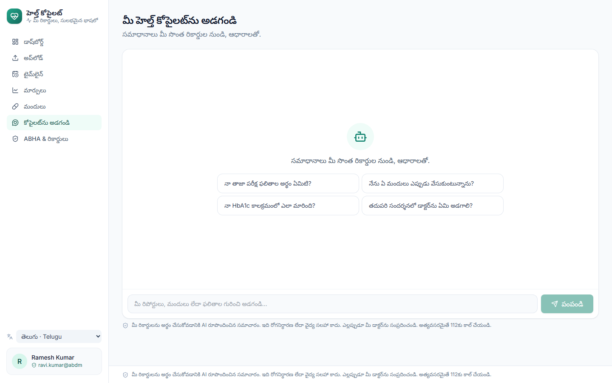

<!-- _class: lead -->
<!-- _paginate: false -->

# Health Copilot

### Your medical papers, read, checked and explained, in your language

Prescriptions · lab reports · discharge summaries → one verified, ABDM-ready health record

 

**Team hack_masters** · Altrix Labs Hackathon · AI-Powered Personal Health Copilot

---

## The problem

- Indian patients carry their history on **paper**: handwritten prescriptions, lab printouts in `lakhs/cumm` and `gm%`, and multi-page discharge summaries.
- The documents mix **English with Hindi, Telugu, Tamil or Kannada**.
- Nobody explains the abnormal values. Old prescriptions linger. Records don't move between hospitals.
- ABDM can carry records between providers, but only if they are **structured FHIR** linked to an **ABHA**.

**What a patient actually needs**

1. Snap a photo and get the data out *correctly*.
2. "What does this result mean? What do I ask my doctor?"
3. One timeline: medicines, results and conditions.
4. In their language.
5. Share it through ABHA.

---

## What we built

Upload or photograph → AI extraction with a second-model check → side-by-side review → unified profile, timeline, trends, medicine schedule, grounded summaries and chat → FHIR / ABHA

---

## AI pipeline: the LLM reads, code decides

Gemini vision with schema-constrained JSON · a **different model** re-reads the page, guided by the validator's suspicious fields · deterministic checks own units, ranges, flags, drug codes, dosage grammar and dates · a human confirms before anything reaches the record

---

<!-- _class: dense -->

## What the code guarantees

**Deterministic validation**
- 60 LOINC tests with unit conversion and sex-specific ranges. The report's own range is used first.
- High, Low and Critical flags are **computed, not generated**.
- 213 Indian brands mapped to generics. Combination brands stay distinct: *Glycomet GP ≠ Glycomet*.
- Dosage grammar: `1-0-1`, `BD`, `HS`, `SOS`, `AC/PC`, weekly, `x 1 month`.
- Day-first Indian dates, BP split into systolic and diastolic, impossible values blocked.

**Grounded explanations**
- Summaries use a fact sheet built from the DB. The model writes prose only.
- Values, flags, schedules and critical banners are attached by code.
- A safety filter blocks dosing advice and diagnoses, and checks that every number is grounded.
- Translations must preserve every number.
- The chat answers only from the patient's records, with citations, and shows an emergency notice for red-flag symptoms.

---

## Measured, not claimed

| On 10 documents / 96 items | Single pass | + Verify |
|---|---|---|
| Field accuracy, end to end | 99.8% | **100%** |
| Medicines F1 | 100% | 100% |
| Lab / vital results F1 | 99.2% | **100%** |
| Diagnoses F1 | 100% | 100% |

Test set: printed, handwritten, phone-photo, multi-page PDF, Hindi, Telugu, Tamil and Kannada documents. Hand-written ground truth; `eval/run_eval.py`.

**What the evaluation caught (and we fixed)**
- The verifier recovered the one value the first pass missed: SpO2 in narrative text.
- Rewording between the passes caused false review flags. We now match on LOINC, generic and ICD-10 codes, so false alarms drop from about 20% to about 1%.
- Combination brands were being collapsed.
- Older prescriptions were staying active.

The samples are synthetic, so real handwriting will be harder. That is why every document is reviewed.

---

## Review UX: human in the loop, where it matters

The deskewed page sits next to editable fields. Badges show confidence, verifier changes and validation issues. Only flagged items need attention; "Looks right" accepts in one tap.

---

## In your language

The UI and AI summaries are available in English, हिन्दी, తెలుగు, தமிழ் and ಕನ್ನಡ. Medical terms keep the English term in brackets. Bilingual and regional-script documents are extracted directly.

---

<!-- _class: dense -->

## ABDM-ready

- Every confirmed document becomes an **NRCeS-profile FHIR R4 Bundle**: PrescriptionRecord, DiagnosticReportRecord or DischargeSummaryRecord. Resources are validated with `fhir.resources`.
- Codes: **LOINC, UCUM, ICD-10, SNOMED** composition types and v3 interpretation codes.
- The **ABHA** number and address are Patient identifiers. The whole record exports as one bundle.
- **Mock ABDM flow:** OTP link, consent artefact, and a pull from a Health Information Provider (HIP). Imported bundles go through the **same validators**.
- Going live means swapping one module for the sandbox gateway.

---

## Architecture

FastAPI · SQLModel (SQLite or Postgres) · background workers · Gemini model chains with fallback (OpenAI drop-in) · React 19 + Vite + Tailwind + TanStack Query + Recharts + i18next · `docker-compose up`

---

## Impact and next steps

**Who it helps**
- Chronic patients (diabetes, BP, thyroid) tracking trends across labs and hospitals.
- Caregivers managing a parent's medicines and schedules.
- Doctors receiving a structured, ABHA-linked history instead of a paper folder.

**Next steps**
- ABDM sandbox: HIU registration and Fidelius encryption.
- Medicine reminders from the extracted schedule, plus interaction checks.
- Grow the evaluation set with real, consented documents, and calibrate confidence on it.
- Voice summaries in regional languages.

 

> AI reads and explains. Code checks. You confirm. Your record, in your language, ready for ABDM.
